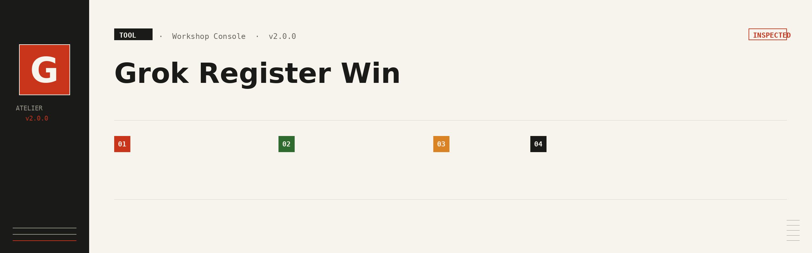

<div align="center">

# Grok Register Win



### Grok（xAI）账号自动注册面板

[](https://github.com/lingxiaoyiyu-hub/grok-register-win/releases)
[](LICENSE)
[](https://www.python.org/downloads/)
[](https://github.com/lingxiaoyiyu-hub/grok-register-win/stargazers)
[](https://github.com/lingxiaoyiyu-hub/grok-register-win/releases)

<br>

**自动注册 · 多邮箱源 · SSO→CPA · NSFW · 多格式导出**

<br>

[📥 快速开始](#快速开始) ·
[✨ 功能](#功能) ·
[📦 发行包](#发行包) ·
[⚙️ 配置](#配置) ·
[❓ 常见问题](#常见问题)

</div>

---

## ⚠️ 免责声明

> 本项目仅供学习研究。自动化注册可能违反平台条款，风险自负。

---

## ✨ 功能

- **代理**：复用 Clash / mihomo 代理（常见端口 `7897`）
- **注册引擎**：Chromium 有头 / Camoufox 无头（面板可切换）
- **邮箱**：多源下拉（CF Worker、MoeMail、LuckMail、MaliAPI、SkyMail、CloudMail、Freemail、OpenTrashMail、Laoudo 等）
- **SSO → CPA**：注册成功后自动换成 CLIProxyAPI 可用的 OAuth JSON
- **上传 SSO 续期**：上传 SSO txt 或 CPA `all.json`，整批换票；旧批次归档到 `data/archive/`
- **NSFW**：注册成功后自动设置相关偏好
- **产物下载**（同一批账号，三种格式）：
  - SSO TXT：`email----password----sso`
  - CPA ZIP：`xai-*.json`（CLIProxyAPI）
  - Sub2 ZIP：Sub2API 导入包（`grok-*.json` + `all.json`）
- **账号管理**：面板勾选删除；注册 / 上传工作区隔离

---

## 📦 发行包

在 [Releases · v2.0.1](https://github.com/lingxiaoyiyu-hub/grok-register-win/releases/tag/v2.0.1) 下载 **Source code**，解压后双击 `start.bat`（使用本机 Clash 管理节点）。

> 自 v2.0.1 起不再提供服务器版发行包，本项目专注 Windows 本地使用。

---

## 📋 环境要求

| 项 | 说明 |
| :--- | :--- |
| 系统 | Windows 10 / 11 |
| Python | 3.10+（勾选 *Add python.exe to PATH*） |
| 代理 | 本机 Clash（Verge / CFW / mihomo 等），在客户端选节点 |
| 浏览器 | Chrome / Edge（有头）；Camoufox 可选，首次自动下载 |

---

## 🚀 快速开始

1. 下载源码 ZIP 并解压  
2. 打开本机 Clash，选可用节点（建议日本）  
3. 双击 `start.bat`（首次会建 `.venv` 装依赖）  
4. 打开 http://127.0.0.1:8787  
5. 配置邮箱 → 开始注册，或上传 SSO 续期  
6. 下载 SSO / CPA / Sub2  

失败日志：`data\logs\start.log`

---

## ⚙️ 配置

首次运行从 `config.example.json` 生成 `config.json`（勿把含密钥的配置公开上传）。

```json
{
  "proxy": "http://127.0.0.1:7897",
  "allow_proxy_fallback": false,
  "browser_engine": "chromium",
  "email_provider": "cfworker",
  "email_failover": true,
  "cfworker_api_url": "https://apimail.example.com",
  "cfworker_admin_token": "your-admin-token",
  "cfworker_domain": "mail.example.com",
  "register_count": 1,
  "round_timeout_sec": 300
}
```

| 字段 | 说明 |
| :--- | :--- |
| `proxy` | HTTP 代理地址；端口不通时会探测本机常见 Clash 端口（**仅本次生效，不写回本文件**） |
| `allow_proxy_fallback` | 代理失败是否改走直连，默认 `false`（关闭时代理失败直接报错，不会暴露真实 IP） |
| `browser_engine` | `chromium`（有头）或 `camoufox`（无头反检测） |
| `email_provider` | 邮箱源 id |
| `email_failover` | 失败时是否换源 |
| `register_count` | 单次任务注册数量 |
| `round_timeout_sec` | 单账号硬超时（秒），默认 `300` |

### 邮箱源

| 标识 | 说明 |
| :--- | :--- |
| `cfworker` | CF Worker / 自建域名（推荐） |
| `moemail` | MoeMail API |
| `maliapi` | MaliAPI / YYDS |
| `luckmail` | LuckMail |
| `skymail` / `cloudmail` | SkyMail / CloudMail |
| `freemail` | Freemail |
| `opentrashmail` | OpenTrashMail |
| `laoudo` | Laoudo 固定邮箱 |

### 环境变量（可选）

| 变量 | 含义 | 默认 |
| :--- | :--- | :--- |
| `PANEL_HOST` | 监听地址（面板只接受本机访问） | `127.0.0.1` |
| `PANEL_PORT` | 端口 | `8787` |
| `PANEL_ALLOWED_HOSTS` | 额外允许的 Host 头，逗号分隔 | — |
| `GROK_PROXY` | 覆盖代理（优先级高于 `config.json`） | — |
| `ROUND_TIMEOUT_SEC` | 覆盖单轮超时 | `300` |

> **关于面板安全**：面板是纯本机工具，只监听回环地址，并会校验请求的
> `Host` 与 `Origin`，拒绝来自其它网页的跨站请求。
> v2.0.0 及更早版本的 `PANEL_AUTH` / `PANEL_PASSWORD` 登录功能已移除 ——
> 它的签名密钥硬编码在源码里，任何人都能伪造登录态，属于假锁。

---

## 📂 目录结构

```
grok-register-win/
├── start.bat                 # 启动入口
├── launcher.py
├── grok_register_ttk.py      # 注册主程序
├── config.example.json
├── panel/app.py              # Web 面板
├── lib/                      # SSO→CPA、邮箱、Camoufox 等
├── tests/                    # 回归测试（pytest）
├── data/
│   ├── logs/
│   ├── cpa/
│   └── archive/
└── accounts_*.txt
```

---

## ❓ 常见问题

<details>
<summary><b>代理端口不通</b></summary>

- 确认 Clash 已启动，混合 / HTTP 端口多为 `7897`  
- 端口不通时会自动探测本机常见端口，并**验证对方确实是 HTTP 代理**才使用  
- 探测结果只对本次运行生效，不会覆盖 `config.json` 里手填的 `proxy`  
</details>

<details>
<summary><b>注册失败多 / 验证码异常</b></summary>

- 多数与出口网络有关；**日本节点**通常更稳  
- 换节点后重试；单账号超时默认 5 分钟会进入下一轮  
</details>

<details>
<summary><b>收不到验证码</b></summary>

- 检查邮箱源 API / Token / 域名是否正确  
- 优先使用可正常收 xAI 邮件的自建或付费源  
</details>

<details>
<summary><b>上传 SSO 续期</b></summary>

- 支持 `email----password----sso` / `email----sso` / 纯 SSO，以及含 `sso` 的 CPA `all.json`  
- 上传会替换当前工作区，旧数据在 `data/archive/`  
</details>

<details>
<summary><b>依赖安装失败</b></summary>

```bat
.venv\Scripts\python.exe -m pip install -r requirements.txt -i https://pypi.tuna.tsinghua.edu.cn/simple
```
</details>

---

## 📝 更新日志

版本变更、移除项、修复说明见 [Releases](https://github.com/lingxiaoyiyu-hub/grok-register-win/releases) 与 `docs/RELEASE_NOTES_*.md`。

<details>
<summary><b>展开近期版本摘要</b></summary>

### v2.0.1
- 修复账号文件勾选框不显示对号
- 面板安全加固：同源校验、移除假的登录功能
- 代理相关修复：不再无视 `allow_proxy_fallback`、不再偷改 `config.json`
- 移除服务器版；清理约 1400 行死代码；补上回归测试与 CI

### v2.0.0
- 面板 Atelier 风格重做、全中文化

### v1.4.0 ~ v1.3.0
- 邮箱源调整、上传 SSO 整批续期、下载与面板账号对齐等  

完整条目见各 Release 说明。
</details>

---

## 💬 反馈与支持

| 类型 | 途径 |
| :--- | :--- |
| Bug | [Issue](https://github.com/lingxiaoyiyu-hub/grok-register-win/issues/new?template=bug_report.yml) |
| 建议 | [Issue](https://github.com/lingxiaoyiyu-hub/grok-register-win/issues/new?template=feature_request.yml) |
| 讨论 | [Discussions](https://github.com/lingxiaoyiyu-hub/grok-register-win/discussions) |

---

## 🤝 贡献

欢迎 Issue / PR。参与前请阅读 [贡献指南](CONTRIBUTING.md) 与 [行为准则](CODE_OF_CONDUCT.md)。

---

## License

[MIT License](LICENSE)

---

<div align="center">

**如果这个项目对你有帮助，欢迎 Star ⭐**

</div>
